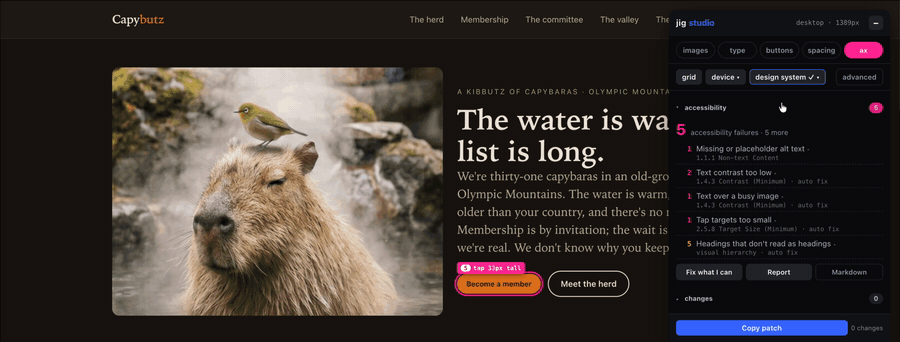

# Jig Studio

**Fix accessibility and layout problems on any website, in its own design system, without opening Figma.**

Add `?jig` to the URL. Everything that fails turns pink; one click fixes most issues. Pick a device and visually edit anything that looks wrong (images, text, buttons, grid, spacing) until it doesn't. Copy the patch and hand it to your AI or developer. It never writes to your site.



The full tour, with videos of each job: **[benjaminmullins.tv/lab/jig-studio](https://benjaminmullins.tv/lab/jig-studio)**.

## Try it in ten seconds

- **A site that's wrong on purpose:** [capybutz.com/?jig](https://capybutz.com/?jig). Seven planted mistakes; the jig finds them.
- **The same site in somebody else's design system:** [capybutz.com/?jig&tokens=https://frontiercreatives.design/tokens.css](https://capybutz.com/?jig&tokens=https://frontiercreatives.design/tokens.css). The patch names *their* steps.
- **Any page you're looking at:** drag the [🦆 bookmarklet](https://capybutz.com/bookmarklet.html) to your bookmarks bar and click it. The bookmarklet is for trying it; installing is for using it.

## Install

Paste this once, anywhere in the page. It does nothing until `?jig` is in the URL, so normal visitors never download the file.

```html
<script>
  /* Jig Studio: does nothing until someone adds ?jig to the URL */
  (function () {
    var on = /[?&]jig(=|&|$)/.test(location.search) || location.hash === '#jig';
    try { on = on || localStorage.getItem('__jig') === '1'; } catch (e) {}
    if (!on) return;
    var s = document.createElement('script');
    s.src = 'https://cdn.jsdelivr.net/gh/mullinsben/jig-studio@v0.1.1/jig.js';   // pinned release; bump when you want a newer one
    // s.setAttribute('data-foundation', 'https://your.site/tokens.json');      // optional: your design system
    document.head.appendChild(s);
  })();
</script>
```

On WordPress that's a code-snippet plugin (WPCode, footer, all pages); on Shopify it's `layout/theme.liquid` before `</body>`; on Squarespace, Wix, Webflow, Ghost and the rest it's the site-wide custom-code or code-injection box. Hosted builders can't take a `.js` upload, which is fine; the snippet loads it from jsDelivr. Prefer to self-host? Copy `jig.js` next to your pages and point `s.src` at it.

Naming things is optional; the jig finds images, text, buttons, sections and overlays by itself. Names make the patch read better:

```html

<div class="cards" data-jig="grid" data-jig-name="Card row">…</div>   <!-- grid is opt-in -->
<aside data-jig="off">…</aside>                                       <!-- leave this alone -->
```

## What it does

A jig, in a workshop, is the fixture that holds the piece so you cut it right every time. This one holds a web page against its design system; if the site doesn't have one, it infers one from the page. Four jobs:

1. **Accessibility.** The **ax** pill is on by default. Contrast is measured from the pixels on screen, including text over photos (fourteen layering techniques cataloged and tested); plus tap targets, alt text, unnamed links and buttons, page language and title, form labels, color-only links, vague link text, heading order, duplicate image links. Design notes (hierarchy, small text, long measure, soft images, a cropped-out face) are listed separately and never counted as failures. Report as a panel, a single-file HTML download (print it for the PDF), or markdown for a ticket.
2. **One-click fixes.** **Fix what I can** applies the WCAG A/AA fixes the jig can verify, with the controls a person would use: an existing overlay darkened before any scrim, a scrim before any tint, never a tint behind a headline; text on a plain background moved to the nearest passing shade of its own hue; a short button stepped up to the tap target with the buttons beside it following. It re-measures what it changed, keeps only what passed, and **undo fixes** puts the page back exactly. The bigger version, **auto fix** under advanced, also snaps every font size, padding, margin and gap to the scales at a strength you choose. Use that one with your eyes open: it makes a page consistent; it can't tell you whether the page was right.
3. **Nudge.** Switch on a pill and only that kind of thing responds. **images**: drag to pan a crop, pinch or ⌘-wheel to zoom, step the width in grid columns. **type**: click any text and step it along the ramp; drag copy and it lands on grid columns only; copy over a photo picks a band and a scrim so it passes. **buttons**: step the size, cycle the variant. **spacing**: step a section's padding along the scale. The toolbar shows the step name, not a pixel value, because the step is what goes in the patch.
4. **Load a design system.** `?jig&tokens=URL`, the **design system** button, or `data-foundation` on the script tag. It reads W3C design tokens JSON (Figma Variables, Tokens Studio, Style Dictionary), a CSS file of `:root` variables, or its own `jig.foundation.json`, and keeps your names. No file? It uses the site's own `--text-*` / `--space-*` variables if the page actually uses them; failing that it measures the page, clusters what it finds into a ramp, a spacing scale, button sizes and a grid, labels the result **inferred**, and proposes it back in the patch as a `:root` block. **Edit scales** lets you correct the guess.

Device frames (iPhone 15 Pro and SE, Pixel 8, Galaxy S24, iPad Mini) open over the dimmed desktop and start from the desktop's current state; changes made in a frame are tagged with the device. On an actual phone the jig is a slim bar with a findings sheet.

## The patch

A markdown half for the person approving, a JSON half for the AI applying; if they ever disagree, the JSON wins. Selectors name exactly one element, values are tokens where the site has them, and the platform is named so the AI applies it that platform's way. [`GIVE-THIS-TO-YOUR-AI.md`](GIVE-THIS-TO-YOUR-AI.md) rides along and tells the model what each control means in source: change tokens and classes, never write pixel values.

```
# jig patch · capybutz · / · 2026-10-29 21:04

- Hero image: crop moved to 50% 81.3%
- Membership CTA: size sm → md (tap target)
- Meet the herd title: ramp 3xl → 2xl (-1) (now smaller than the h1)

⚠ 1 note (accessibility):
- Annex: Puppy stack: alt text looks like a placeholder: "IMG_4471.jpg"

---
[
  { "el": "[data-jig-name=\"Hero image\"]", "ctl": "crop", "bp": "desktop", "objectPosition": "50% 81.3%" },
  { "el": "[data-jig-name=\"Membership CTA\"]", "ctl": "button", "bp": "desktop", "size": "md" },
  { "el": "[data-jig-name=\"Meet the herd title\"]", "ctl": "type", "bp": "desktop", "from": "3xl", "to": "2xl", "step": -1, "px": 32, "var": "--text-2xl" },
  { "warn": "alt", "el": "[data-jig-name=\"Annex: Puppy stack\"]", "msg": "alt text looks like a placeholder: \"IMG_4471.jpg\"" }
]
```

## Rules and limits

Three rules decide what gets built, and `npm test` holds every pull request to them:

1. **Loading it changes nothing.** `?jig` must not move a pixel until someone touches something; a screenshot check with and without the jig fails the build on any difference outside the panel.
2. **Never guess; say so.** What it can't measure becomes a note ("couldn't tell, check by eye"), never a fix.
3. **Nudge within the system, never invent.** Every move is a step on a scale the site has or the jig inferred. No color picker, no free positioning.

What it doesn't do, yet or on purpose: change colors beyond moving text to a passing shade of its own hue (color tokens are read, not yet used); validate the ARIA tree, keyboard order or screen-reader output the way axe and a keyboard pass do, so a clean report is a good sign, not a conformance claim; write to any site or CMS; audit more than one page at a time (a sitemap-wide pass would make a fine first contribution). As a bookmarklet it won't run on strict-CSP sites or read photos from CDNs that refuse CORS; installed on your own site, both go away.

## Run it locally

```bash
git clone https://github.com/mullinsben/jig-studio.git
cd jig-studio
python3 -m http.server 8000      # any static server; file:// blocks image sampling
```

Open <http://localhost:8000/demo/?jig> (Capybutz, seven things wrong on purpose) or <http://localhost:8000/demo/legacy/?jig> (the 2016 version, no design system at all). `npm install && npx playwright install chromium && npm test` runs the suite; see [tests/README.md](tests/README.md).

## Contributing

Bugs from real sites, accessibility rules and text-over-image techniques are the contributions we want most; see [CONTRIBUTING.md](CONTRIBUTING.md) for the three rules every change is held to, how to add a rule, and how the tests work. This project follows the [Contributor Covenant](CODE_OF_CONDUCT.md).

## Status

v0.1.1; see [CHANGELOG.md](CHANGELOG.md). MIT. "Jig Studio" is this project's name; forks, please choose your own. The capybaras are real.
